# Smart SDN Network Management & Adaptive Traffic Optimization System

> **Course:** SDN–Socket Programming Mini Project  
> **Project stage:** Deliverable 2  
> **Deployment model:** Single Ubuntu VM using Mininet, Open vSwitch and Ryu  

A Software-Defined Networking (SDN) project that protects UDP time-synchronization traffic from network congestion. The Mininet testbed provides two parallel paths with different bandwidth and delay characteristics. A Ryu SDN controller monitors the slow path and dynamically changes the forwarding rules for synchronization traffic when congestion crosses configured thresholds. A Flask dashboard provides live monitoring, experiment controls, experiment history and downloadable reports.

This repository contains the C socket-programming application, the Mininet topology, the Ryu controller, the dashboard, startup and verification scripts, and build instructions.

---

## Contents

- [1. Problem statement](#1-problem-statement)
- [2. Objectives](#2-objectives)
- [3. Main functionality](#3-main-functionality)
- [4. System architecture and design](#4-system-architecture-and-design)
- [5. Network topology](#5-network-topology)
- [6. Congestion detection and adaptive routing](#6-congestion-detection-and-adaptive-routing)
- [7. Socket application and message flow](#7-socket-application-and-message-flow)
- [8. Repository structure](#8-repository-structure)
- [9. Requirements](#9-requirements)
- [10. Installation and setup](#10-installation-and-setup)
- [11. Running the project](#11-running-the-project)
- [12. Running experiments](#12-running-experiments)
- [13. Monitoring, logs and reports](#13-monitoring-logs-and-reports)
- [14. Performance evaluation](#14-performance-evaluation)
- [15. Screenshots and demonstration video](#15-screenshots-and-demonstration-video)
- [16. Team contributions](#16-team-contributions)
- [17. Known limitations and future improvements](#17-known-limitations-and-future-improvements)
- [18. Mapping to the project evaluation rubric](#18-mapping-to-the-project-evaluation-rubric)

---

## 1. Problem statement

Network congestion can increase packet delay and cause packet loss. These effects can reduce the quality and reliability of applications that depend on timely message exchange, including time-synchronization applications.

The project demonstrates how an SDN controller can respond to changing network conditions. Instead of keeping synchronization traffic on one fixed route, the controller monitors the utilisation of a constrained link and updates OpenFlow forwarding rules to move synchronization packets between a slower path and a faster path.

The application is implemented with UDP sockets in C and tested in a Mininet-based network controlled by Ryu and Open vSwitch. The complete test environment is designed to run on one Ubuntu virtual machine.

## 2. Objectives

1. Design and implement a networked application using low-level UDP socket programming in C.
2. Build a Mininet topology containing multiple clients, a server, traffic generators and two OpenFlow switches.
3. Integrate the socket application with an SDN-controlled network using Ryu and Open vSwitch.
4. Create parallel slow and fast network paths with different bandwidth and delay characteristics.
5. Generate different congestion conditions using UDP traffic, TCP flows and burst traffic.
6. Monitor slow-link utilisation and dynamically reroute synchronization traffic when the configured congestion thresholds are crossed.
7. Measure synchronization-related performance, including round-trip time (RTT), jitter, timeout-based packet loss and synchronization error.
8. Provide a web dashboard for network monitoring, experiment control, experiment history and report generation.
9. Compare the observed behaviour under baseline and congestion scenarios and document the results so that the experiments can be reproduced.

## 3. Main functionality

| Component | Functionality |
|---|---|
| Ryu SDN controller | Uses OpenFlow 1.3, installs forwarding rules, requests switch port statistics and dynamically selects the SLOW or FAST path for UDP synchronization traffic. |
| Mininet topology | Creates two OpenFlow switches, seven hosts, a time server, three synchronization clients and three background traffic generators. |
| Open vSwitch | Implements the software switches and applies the forwarding rules sent by Ryu. |
| UDP time-synchronization application | Three C clients exchange timestamped UDP messages with a C server and record RTT and offset-related measurements. |
| UDP congestion generators | Generate Low, Moderate, High and Extreme background traffic from three Mininet hosts. |
| TCP and burst traffic | Provide additional traffic patterns for more challenging network scenarios. |
| Link impairment controls | Apply configurable delay, jitter and packet loss to the slow path using Linux `tc`/netem. |
| Flask dashboard | Displays controller state, selected path, network statistics, synchronization measurements and controller logs; provides controls for traffic and experiments. |
| Experiment manager | Runs a sequence of baseline, congestion and recovery stages and records the collected samples. |
| Reporting | Stores experiment history in SQLite and provides per-run CSV, all-runs CSV and PDF reports. |

### Adaptive-routing policy defaults

| Parameter | Default |
|---|---:|
| Slow path bandwidth | 5 Mbps |
| Slow path delay | 50 ms |
| Fast path bandwidth | 20 Mbps |
| Fast path delay | 5 ms |
| High congestion threshold | 2.5 Mbps |
| Low congestion threshold | 0.8 Mbps |
| Hold-down interval | 4 seconds |
| Controller monitoring interval | 2 seconds |
| Synchronization protocol | UDP |
| Synchronization port | 5005 |
| Background UDP port | 6000 |

Thresholds and monitoring parameters can be configured through environment variables as described in the controller section.

---

## 4. System architecture and design

The system has three main layers:

1. **Application layer:** C-based UDP synchronization clients and server, together with background traffic generators.
2. **SDN/network layer:** Mininet hosts, Open vSwitch switches, parallel links and the Ryu controller.
3. **Monitoring and experiment layer:** Flask dashboard, experiment manager, SQLite history and CSV/PDF report generation.

### Architecture diagram

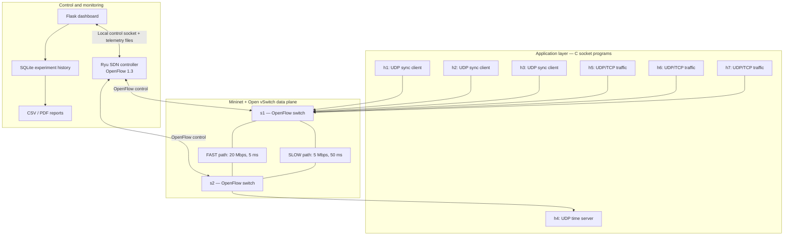

### Component responsibilities

- **C clients and server:** perform UDP timestamp exchanges. The clients calculate RTT and offset-related values and write their results to CSV-format log files.
- **Background generators:** create competing traffic so the controller has measurable load to observe on the slow path.
- **Mininet:** creates the virtual hosts, links and network namespaces on the Ubuntu VM.
- **Open vSwitch:** forwards packets according to the flow rules installed by the controller.
- **Ryu:** monitors the slow-link transmit-byte counters and changes the forwarding rules for synchronization packets.
- **Dashboard:** reads controller telemetry and synchronization logs, sends permitted experiment commands to the Mininet process, and displays the resulting measurements.
- **SQLite and report generator:** store experiment samples and generate downloadable summaries.

## 5. Network topology

The Mininet topology contains two OpenFlow 1.3 switches and seven hosts.

| Host | IP address | Role |
|---|---|---|
| h1 | `10.0.0.1` | UDP synchronization client 1 |
| h2 | `10.0.0.2` | UDP synchronization client 2 |
| h3 | `10.0.0.3` | UDP synchronization client 3 |
| h4 | `10.0.0.10` | UDP time server |
| h5 | `10.0.0.50` | Background traffic generator 1 |
| h6 | `10.0.0.51` | Background traffic generator 2 |
| h7 | `10.0.0.52` | Background traffic generator 3 |

### Switch and link details

| Link | OpenFlow ports | Bandwidth | Configured delay | Purpose |
|---|---|---:|---:|---|
| Slow inter-switch link | s1 port 5 ↔ s2 port 2 | 5 Mbps | 50 ms | Constrained path and congestion measurement point |
| Fast inter-switch link | s1 port 6 ↔ s2 port 3 | 20 Mbps | 5 ms | Alternate path for synchronization traffic |

The three synchronization clients and the three background generators connect to s1. The time server connects to s2. The two parallel links connect s1 and s2.

### Topology diagram

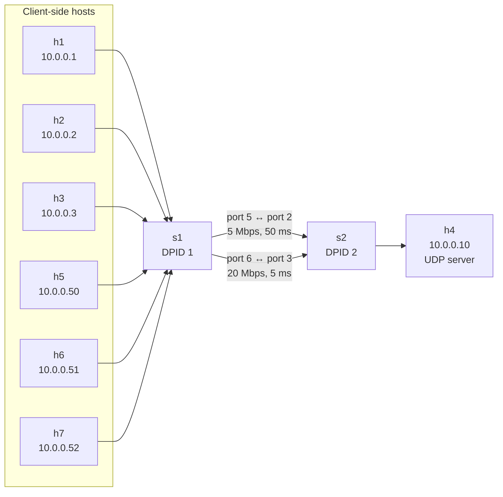

## 6. Congestion detection and adaptive routing

The controller starts with synchronization traffic on the SLOW path. Background UDP traffic is deliberately directed through the SLOW path so that congestion can be generated and measured.

### Controller operation

1. Ryu connects to the two Open vSwitch switches using OpenFlow 1.3.
2. The controller installs the initial forwarding rules. Synchronization traffic uses the SLOW path by default.
3. The controller periodically requests port statistics for the slow-link egress port on s1.
4. It calculates the transmit rate from the difference between successive byte counters and the elapsed sampling time.
5. If the measured rate reaches or exceeds the high threshold (default `2.5 Mbps`), the controller updates the synchronization flow rules on s1 and s2 to use the FAST path.
6. If the measured rate falls to or below the low threshold (default `0.8 Mbps`), the controller can return synchronization traffic to the SLOW path, subject to the hold-down interval.
7. The controller writes its current state to `logs/controller_status.json` and logs measurements and route changes in `logs/controller.log`.

The separate high and low thresholds provide hysteresis. The hold-down interval helps prevent rapid repeated path changes when measured utilisation fluctuates around a threshold.

### Traffic classification

- Synchronization requests are identified as UDP traffic destined for server `10.0.0.10` on port `5005`.
- Synchronization replies are identified as UDP traffic sourced from server `10.0.0.10` on port `5005`.
- Background UDP traffic uses destination port `6000` and is pinned to the SLOW path.
- Other client-to-server IPv4 traffic follows the default slow-path forwarding rule in the current controller implementation.

### Controller configuration

The startup script supplies these defaults if the variables are not already set:

```bash
SYNC_POLICY=dynamic
HIGH_THRESHOLD_MBPS=2.5
LOW_THRESHOLD_MBPS=0.8
```

The controller also reads:

```bash
ROUTE_HOLD_DOWN=4
MONITOR_INTERVAL=2
```

Example of starting with custom values:

```bash
export SYNC_POLICY=dynamic
export HIGH_THRESHOLD_MBPS=2.5
export LOW_THRESHOLD_MBPS=0.8
export ROUTE_HOLD_DOWN=4
export MONITOR_INTERVAL=2
./scripts/start_controller.sh
```

Use `SYNC_POLICY=static` to disable dynamic utilisation-based path switching for a static-policy comparison. Confirm the active policy in the controller log/dashboard before recording a comparison run.

## 7. Socket application and message flow

The project uses UDP sockets implemented directly in C.

### Time synchronization

- The server runs on h4 and listens on UDP port `5005`.
- Three clients run on h1, h2 and h3.
- A client sends a timestamped synchronization request.
- The server records receive and reply timestamps and returns a UDP response.
- The client records the response and calculates RTT and offset-related measurements.
- Each client writes its measurements to a separate log file under `logs/`.

The client uses a simulated logical clock offset for the experiment. It does **not** change the Ubuntu VM's system clock.

### Background traffic

The background sender runs on h5, h6 and h7. It sends UDP packets to h4 on port `6000` at a configured rate for a configured duration. The server has a separate background UDP receiver.

### Ports

| Port | Protocol | Purpose |
|---|---|---|
| 5005 | UDP | Time-synchronization request and response |
| 6000 | UDP | Background traffic |
| 5201 onward | TCP | Optional iperf3 traffic tests |
| 6633 | TCP | Ryu OpenFlow controller connection |
| 8765 | TCP, localhost | Mininet-to-dashboard control socket |
| 5000 | HTTP, localhost | Flask dashboard |

## 8. Repository structure

```text
smart-sdn-project/
├── controller/
│   └── sdn_controller.py          # Ryu controller and adaptive path policy
├── topology/
│   └── network_topology.py        # Mininet topology and local control socket
├── dashboard/
│   ├── app.py                     # Flask routes and dashboard backend
│   ├── collector.py               # Live telemetry and sync-log collector
│   ├── experiments.py             # Automated experiment runner
│   ├── mnctl.py                   # Local Mininet control-socket client
│   ├── reports.py                 # CSV and PDF report generation
│   ├── store.py                   # SQLite experiment storage
│   ├── templates/
│   │   └── index.html             # Dashboard page
│   └── static/
│       ├── dashboard.js           # Dashboard interactions and charts
│       └── style.css              # Dashboard styling
├── scripts/
│   ├── start_controller.sh        # Start Ryu
│   ├── start_topology.sh          # Build binaries if needed and start Mininet
│   ├── start_dashboard.sh         # Install dashboard requirements and start Flask
│   └── verify.sh                  # Check the running stack
├── server.c                       # UDP time server and background receiver
├── client.c                       # UDP synchronization client
├── background_sender.c            # UDP congestion traffic generator
├── Makefile                       # Builds the C executables
├── requirements.txt               # Flask and ReportLab dependencies
├── results/
│   └── .gitkeep                   # Generated experiment database is not committed
├── reports/
│   └── .gitkeep                   # Location for generated reports, if required
├── .gitignore
└── README.md
```

Runtime folders such as `logs/` and generated binaries/database files are intentionally excluded from version control by `.gitignore`. They are created during execution.

## 9. Requirements

### Software

- Ubuntu 22.04 LTS (the development environment used for this project).
- Python 3.
- Ryu SDN framework installed in a Python virtual environment.
- Mininet.
- Open vSwitch with OpenFlow 1.3 support.
- GCC and GNU Make.
- Flask and ReportLab (installed from `requirements.txt`).
- `iperf3` for optional TCP congestion tests.
- Linux `tc` with the `htb` and `netem` queuing disciplines.

### Hardware

A single Ubuntu VM/laptop capable of running Mininet, Open vSwitch, Ryu and the dashboard simultaneously. Resource requirements depend on the host machine and experiment intensity.

> **Environment note:** `scripts/start_controller.sh` and `scripts/start_dashboard.sh` expect the Ryu virtual environment at `~/ryu39-venv`. If your environment uses a different path, update those scripts or create the virtual environment at the expected path. Ryu is a separate prerequisite; it is not installed by `requirements.txt`.

## 10. Installation and setup

### 10.1 Install system packages

```bash
sudo apt update
sudo apt install -y \
  mininet openvswitch-switch \
  build-essential gcc make \
  python3 python3-venv python3-pip \
  iperf3 curl
```

Ensure Open vSwitch is running:

```bash
sudo systemctl enable --now openvswitch-switch
sudo systemctl status openvswitch-switch
```

### 10.2 Clone the repository

```bash
git clone <YOUR_PUBLIC_GITHUB_REPOSITORY_URL>
cd smart-sdn-project
```

Replace the URL with the public repository URL after creating it on GitHub. If your repository's directory name differs, use that directory name in the commands below.

### 10.3 Prepare the Python environment

Create the expected virtual environment if it does not already exist:

```bash
python3 -m venv ~/ryu39-venv
source ~/ryu39-venv/bin/activate
python -m pip install --upgrade pip
```

Install Ryu in this environment using the version/installation procedure validated for your Ubuntu setup. Then install the dashboard dependencies:

```bash
python -m pip install -r requirements.txt
```

Verify the imports and Ryu command:

```bash
ryu-manager --version
python -c "import flask, reportlab; print('Dashboard dependencies OK')"
```

### 10.4 Build the C socket programs

From the repository root:

```bash
make
```

This creates:

- `time_client`
- `time_server`
- `background_sender`

To remove the generated binaries and rebuild:

```bash
make clean
make
```

### 10.5 Allow dashboard access to Open vSwitch counters

The dashboard calls `ovs-ofctl` through `sudo -n` to read switch port statistics. Configure a narrowly scoped sudoers entry for the Ubuntu account that runs the dashboard. Replace `YOUR_USER` with your Linux username:

```bash
echo 'YOUR_USER ALL=(root) NOPASSWD: /usr/bin/ovs-ofctl' | \
  sudo tee /etc/sudoers.d/smart-sdn
sudo chmod 440 /etc/sudoers.d/smart-sdn
sudo visudo -cf /etc/sudoers.d/smart-sdn
```

Do not grant broad passwordless `sudo` access. Remove this file if the dashboard no longer needs the permission:

```bash
sudo rm -f /etc/sudoers.d/smart-sdn
```

## 11. Running the project

Start the components in the following order. Keep each terminal open while the experiment is running.

### Terminal 1 — Ryu controller

```bash
cd ~/smart-sdn-project
source ~/ryu39-venv/bin/activate
./scripts/start_controller.sh
```

Wait until the controller starts and reports switch connections.

### Terminal 2 — Mininet topology

```bash
cd ~/smart-sdn-project
sudo -E ./scripts/start_topology.sh
```

Keep the `mininet>` prompt open. The topology script starts the UDP time server on h4 and opens a local control socket for the dashboard.

### Terminal 3 — Flask dashboard

```bash
cd ~/smart-sdn-project
source ~/ryu39-venv/bin/activate
./scripts/start_dashboard.sh
```

Open the dashboard in a browser:

**http://127.0.0.1:5000**

The dashboard and Mininet control socket are configured for localhost access.

### Basic connectivity test

At the `mininet>` prompt:

```text
status
h1 ping -c 3 10.0.0.10
sync 40
```

The synchronization client results are written to `logs/h1-sync.csv`, `logs/h2-sync.csv` and `logs/h3-sync.csv`.

### Verify the running stack

Open a fourth terminal:

```bash
cd ~/smart-sdn-project
./scripts/verify.sh
```

The script checks the Ryu listening port, Mininet control socket, dashboard endpoint, controller telemetry, controller log events, slow-link shaping, synchronization output and switch flow rules.

### Cleanup

Exit the Mininet CLI using `exit`, then clean up stale Mininet state if needed:

```bash
sudo mn -c
```

Stop the Ryu and dashboard processes with `Ctrl+C` in their respective terminals.

## 12. Running experiments

Experiments can be started from the Mininet CLI or through the dashboard controls.

### 12.1 UDP congestion levels

At the `mininet>` prompt:

```text
scenario low 120
scenario moderate 120
scenario high 120
scenario extreme 120
```

The current topology configures three background generators with these per-host UDP rates:

| Scenario | h5 | h6 | h7 | Aggregate offered rate |
|---|---:|---:|---:|---:|
| Low | 0.5 Mbps | 0.5 Mbps | 0.5 Mbps | 1.5 Mbps |
| Moderate | 1.0 Mbps | 1.0 Mbps | 1.0 Mbps | 3.0 Mbps |
| High | 2.0 Mbps | 2.0 Mbps | 2.0 Mbps | 6.0 Mbps |
| Extreme | 3.0 Mbps | 3.0 Mbps | 3.0 Mbps | 9.0 Mbps |

The aggregate offered rate is greater than the configured 5 Mbps slow-link capacity in the High and Extreme scenarios. Actual measured throughput may differ due to protocol overhead, host scheduling, queues and packet loss.

Stop background traffic:

```text
stoptraffic
```

### 12.2 TCP traffic

If `iperf3` is installed:

```text
tcp 60 2
```

This starts two competing TCP flows. The dashboard also exposes TCP experiment controls.

### 12.3 Burst traffic

```text
burst 60
```

The burst generator uses repeating on/off UDP traffic (default 4 seconds sending, 3 seconds idle).

### 12.4 Delay, jitter and packet loss

The Mininet CLI supports:

```text
netem 200 10
```

This applies 200 ms delay and 10% packet loss to the slow-path egress interface. The dashboard can also set delay, jitter and loss and reset the impairment.

Use the dashboard's reset control or:

```text
netem 50 0
```

to restore the configured base delay and zero loss.

### 12.5 Automatic experiment

The dashboard's experiment manager can run a sequence containing:

1. Baseline
2. Low congestion
3. Moderate congestion
4. High congestion
5. Extreme congestion
6. Optional TCP traffic stage
7. Optional burst traffic stage
8. Recovery

The runner starts synchronization clients, samples the telemetry during each stage, records route-change events and stores the run status. The dashboard also supports a single-level experiment mode.

## 13. Monitoring, logs and reports

### Live dashboard

The dashboard provides the following views and controls, based on the current implementation:

- Current controller policy and selected SLOW/FAST path.
- Controller telemetry and switch port counters.
- Slow-link throughput history.
- Synchronization RTT, jitter, timeout-derived loss and synchronization-error measurements when samples are available.
- Recent Ryu controller log output.
- Synchronization and background-traffic controls.
- UDP congestion levels, TCP flows, burst traffic and link impairment controls.
- Automatic experiment start/stop and experiment history.
- CSV and PDF report downloads for completed or recorded runs.

Some dashboard metrics display `n/a` until the corresponding clients have produced samples.

### Runtime output

Generated files are stored locally:

| File or folder | Purpose |
|---|---|
| `logs/controller.log` | Ryu controller output, metrics and route-change events |
| `logs/controller_status.json` | Latest controller telemetry for the dashboard |
| `logs/server.log` | Time-server output |
| `logs/h1-sync.csv` to `logs/h3-sync.csv` | Synchronization-client measurements |
| `logs/h5-*.log` to `logs/h7-*.log` | Background traffic output |
| `results/experiments.db` | SQLite experiment history and samples |
| Dashboard CSV endpoints | Per-run and all-runs CSV exports |
| Dashboard PDF endpoint | Per-run PDF report |

Logs, generated executables and the experiment database are runtime artefacts and are not committed by default.

## 14. Performance evaluation

The project is intended to evaluate how adaptive routing behaves as offered load on the slow path increases.

### Metrics

| Metric | Meaning | Source |
|---|---|---|
| Slow-link throughput (Mbps) | Estimated egress rate on the constrained link | Ryu port statistics |
| RTT (ms) | Round-trip time for a synchronization exchange, excluding server processing time as calculated by the client | UDP synchronization client |
| Jitter (ms) | Difference between consecutive RTT samples, aggregated by the dashboard | Dashboard collector |
| Timeout-derived loss (%) | Percentage of synchronization attempts that time out in the collected samples | Dashboard collector |
| Synchronization error (ms) | Client-side offset-estimation error fields recorded by the client | UDP synchronization client |
| Route changes | Number and details of SLOW/FAST transitions | Ryu controller telemetry and experiment store |

### Recommended comparison procedure

For a fair evaluation, keep the topology and test duration consistent between runs:

1. Run a baseline with background traffic stopped.
2. Run the same synchronization workload while generating Low, Moderate, High and Extreme UDP traffic.
3. Record when the controller changes the path and how long it remains on each path.
4. Run TCP and burst tests as additional challenging scenarios.
5. Apply delay/jitter/loss to the slow path and record the observed synchronization behaviour.
6. Run a static-policy comparison using `SYNC_POLICY=static`, then repeat the same traffic profile and duration.
7. Compare throughput, RTT, jitter, timeout-derived loss, synchronization error and route-change events.
8. Export the CSV and PDF reports and include the actual measured values in the presentation.

**Important:** Do not insert assumed or illustrative values as measured project results. The final report and presentation should use values collected from your own experiment runs. The PDF report can show `n/a` where a run did not collect enough data for a metric.

## ## 15. Screenshots and Demonstration Video

### 15.1 Project Demonstration Video

The complete demonstration of the Smart SDN-Based Network Management and Adaptive Traffic Optimization System is available on YouTube.

**YouTube Demo:** [Watch Project Demonstration] https://youtu.be/LDrB2Igv7u4

### 15.2 Project Screenshots

The following screenshots demonstrate the implementation and functionality of the project.

#### 1. Dashboard Overview

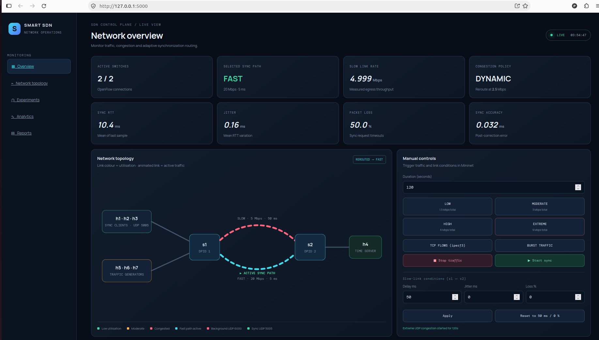

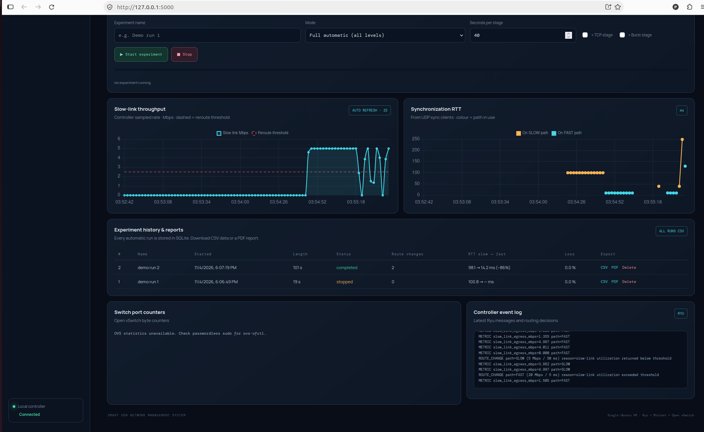

#### 2. Network Topology

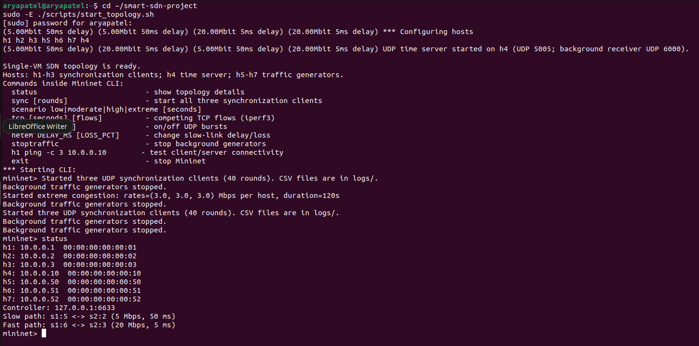

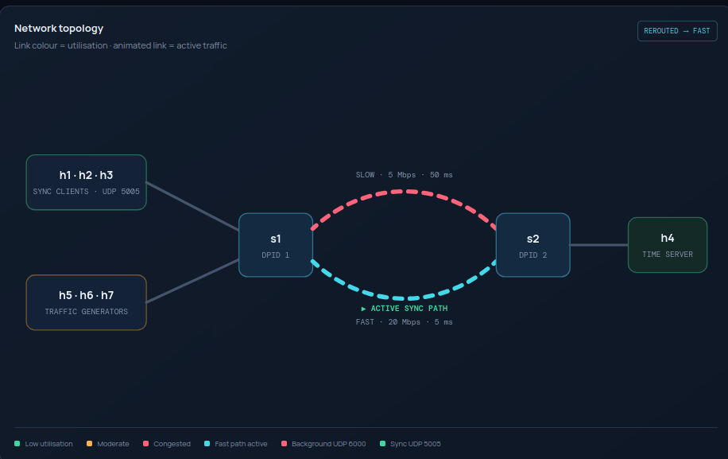

#### 3. EXTREME TRAFFIC RUN


#### 4. Dynamic Path Switching

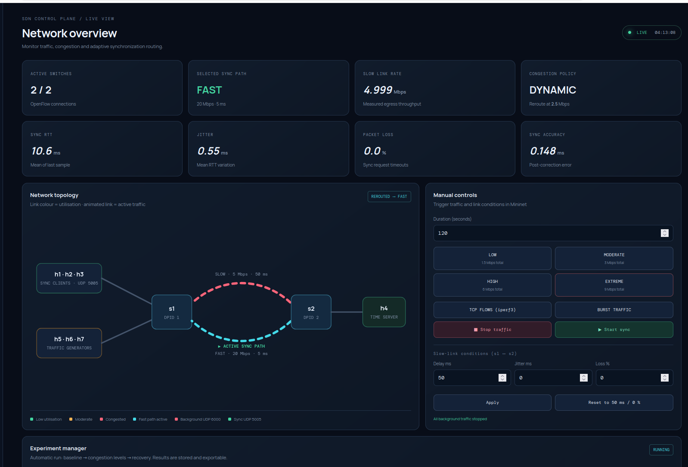

#### 5. Controller Logs

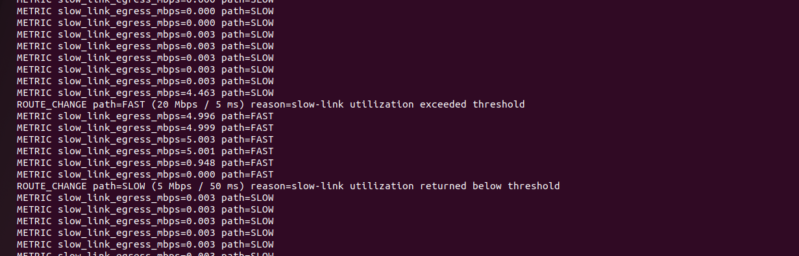

#### 6. Baseline Run & Result

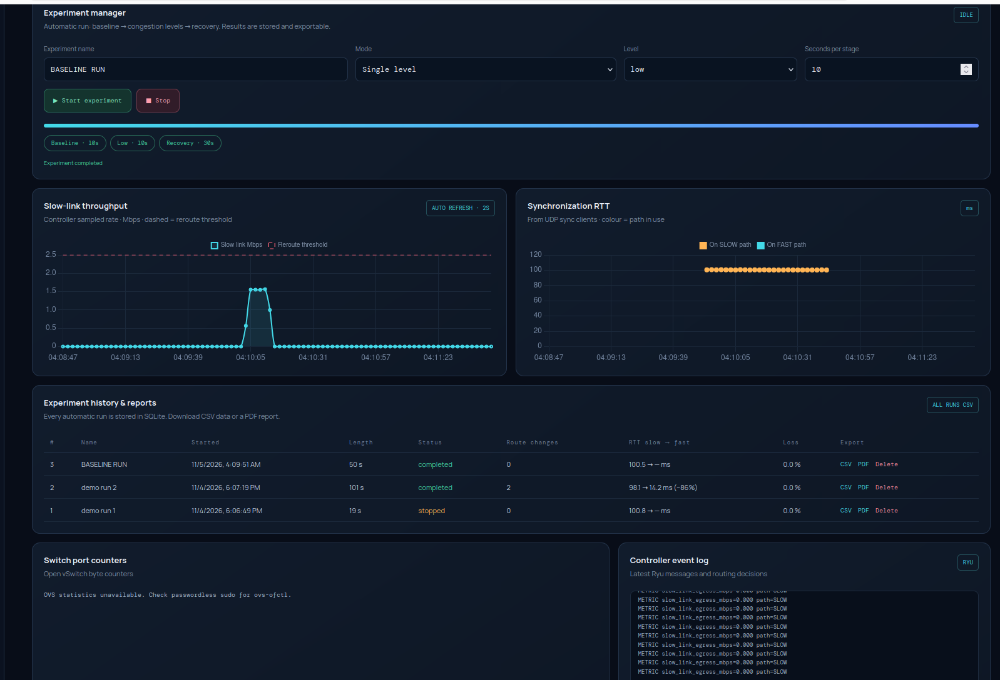

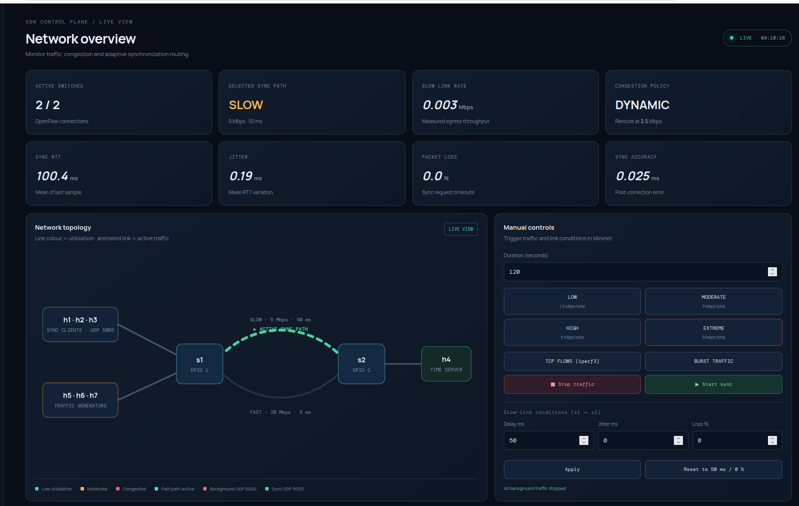

#### 7. Burst test Path Changes in Controller


#### 8. Dashboard Activation (Terminal 3)

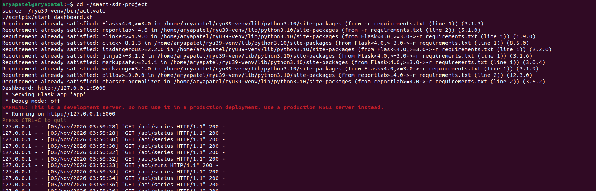

#### 9. RYU Controller Activation (Terminal 1)

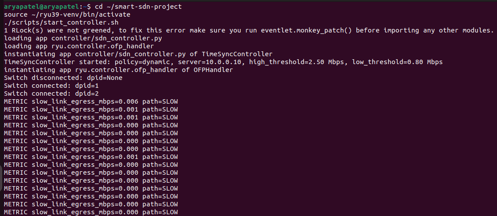


All screenshots are available in the `docs/screenshots/` directory.

## 16. Experiment Results and PDF Reports

This section provides access to the detailed experimental results obtained from the Smart SDN-Based Network Management and Adaptive Traffic Optimization System.

PDF reports have been prepared to document the performance and behaviour of the system under different network conditions. These reports provide supporting evidence for the experiments conducted, including congestion handling, UDP traffic behaviour, adaptive path selection and synchronization performance.


### 16.1 Low Congestion Experiment

Evaluates system performance under low background UDP traffic and observes the effect on network utilisation, round-trip time and synchronization accuracy.

**PDF Report:** [Download Low Congestion Results](docs/reports/LOW-RUN-REPORT.pdf)

### 16.2 Moderate Congestion Experiment

Examines the behaviour of the network under moderate background traffic and evaluates changes in link utilisation, packet delivery and synchronization performance.

**PDF Report:** [Download Moderate Congestion Results](docs/reports/MODERATE-RUN-REPORT.pdf)

### 16.3 High Congestion Experiment

Evaluates the system under high background traffic conditions and demonstrates how increased network utilisation affects synchronization traffic and path selection.

**PDF Report:** [Download High Congestion Results](docs/reports/HIGH-RUN-REPORT.pdf)

### 16.4 Extreme Congestion Experiment

Demonstrates system behaviour under extreme background traffic conditions. This experiment helps evaluate the controller's congestion detection mechanism and adaptive switching between the SLOW and FAST paths.

**PDF Report:** [Download Extreme Congestion Results](docs/reports/EXTREME-RUN-REPORT.pdf)


### 16.5 Burst Traffic Experiment

how the network performs when traffic is generated in bursts, with active periods followed by idle periods.

**PDF Report:** [Download Burst Traffic Results](docs/reports/BURST-RUN-REPORT.pdf)


### 16.6 Complete Experiment Reports

All available experiment reports are organised in the following GitHub directory:

**[View All Experiment Reports](docs/reports/)**

These reports supplement the screenshots and demonstration video and provide detailed evidence of the project's experimental evaluation.


## 17. Team contributions

## Team Members and Contributions

| Team Member | SRN | Contributions |
|---|---|---|
| **Patel Arya Ajaykumar** | PES1UG25CS361 | **SDN Controller and Dashboard Development:** Designed and implemented the Ryu-based SDN controller using Python. Developed OpenFlow rules for traffic forwarding and path management. Implemented congestion monitoring and adaptive path selection to switch synchronization traffic between the slow and fast paths based on network conditions. Developed the Flask-based web dashboard to display network status, selected paths, traffic statistics, synchronization performance and experiment results. |
| **Nadella Harshith** | PES1UG25CS319 | **Client-Side Development:** Developed the UDP time synchronization client in C. Implemented socket communication between clients and the time server. Worked on sending synchronization requests, receiving server responses, recording timestamps and calculating synchronization-related measurements. Contributed to client-side result collection and logging to evaluate synchronization performance under different network conditions. |
| **Nihar Nandan Reddy** | PES1UG25CS336 | **Server-Side Development:** Developed the UDP time synchronization server in C. Implemented socket creation, binding, request reception and response transmission. Handled timestamp generation and exchange between the server and clients. Contributed to the server-side communication logic required for calculating round-trip time and clock offset during synchronization experiments. |
| **All Team Members** | — | **Integration, Testing and Project Demonstration:** Collaborated to integrate the Ryu controller, Mininet network topology, UDP client-server applications and Flask dashboard. Participated in debugging, testing and validating the complete system. Conducted network experiments under different traffic and congestion conditions, verified adaptive path switching and synchronization performance, and contributed to project documentation, screenshots, GitHub repository preparation and final demonstration. |

## 18. Known limitations and future improvements

### Current implementation limitations

- The dynamic path-selection decision is based on slow-link utilisation measured from OpenFlow port statistics. RTT and packet-loss measurements are collected for evaluation but are not currently inputs to the controller's routing decision.
- The time-synchronization client uses a simulated logical clock offset for experimentation; it does not discipline or change the host operating-system clock.
- The dashboard depends on the Mininet process remaining active and its localhost control socket being available.
- The current topology and controller rules are configured for the two-switch, seven-host single-VM testbed described above.
- Generated logs, experiment history and reports are local runtime data and must be deliberately added to the repository only when they are suitable for sharing.

### Possible future improvements

- Add RTT- and packet-loss-aware routing decisions.
- Evaluate alternative congestion thresholds and hold-down intervals.
- Add controller recovery behaviour for switch or link failure.
- Add more traffic patterns and larger client populations.
- Add automated baseline-versus-dynamic comparison summaries.
- Improve experiment reproducibility by storing all configuration values with each run.
- Add authentication and access controls before exposing the dashboard beyond localhost.


## 19. Mapping to the Project Evaluation Rubric

The course rubric evaluates socket programming, Mininet and SDN implementation, application/SDN integration, dynamic SDN behaviour, challenging network scenarios, performance evaluation and project documentation.

| Evaluation Area | Project Evidence to Demonstrate |
|---|---|
| Problem understanding and architecture | Problem statement, project objectives, system architecture and network topology diagrams documented in this README. |
| TCP/UDP traffic generation and socket implementation | `client.c`, `server.c` and `background_sender.c` demonstrate UDP socket communication. TCP competing traffic is generated using `iperf3`. |
| Mininet and SDN implementation | `topology/network_topology.py`, `controller/sdn_controller.py`, Mininet topology, Open vSwitch switches and OpenFlow 1.3 flow rules. |
| Socket–SDN integration | UDP synchronisation packets are classified and forwarded using OpenFlow rules installed by the Ryu controller. |
| Complete application functionality | Three synchronisation clients, one time server, background traffic generators and dashboard controls. |
| Dynamic SDN functionality | Live port-rate monitoring and demonstration of SLOW/FAST path changes in response to network utilisation. |
| Challenging scenarios and robustness | Demonstration of different congestion levels,burst traffic and network delay, jitter and packet-loss impairment. |
| Performance evaluation and comparison | Evaluation using RTT, throughput, jitter, timeout-derived packet loss and synchronisation-error measurements; comparison of static and dynamic routing policies where applicable. |
| Documentation, final demonstration and viva | README, architecture and topology diagrams, screenshots, YouTube demonstration video, team contribution table and reproducible execution instructions. |

---

## Acknowledgements

This project was developed as part of the SDN–Socket Programming mini-project. It uses open-source technologies including Ryu, Mininet, Open vSwitch, Flask and Linux networking tools.

## License

`[Choose and add a license if the team intends to publish the source under an open-source license.]`
