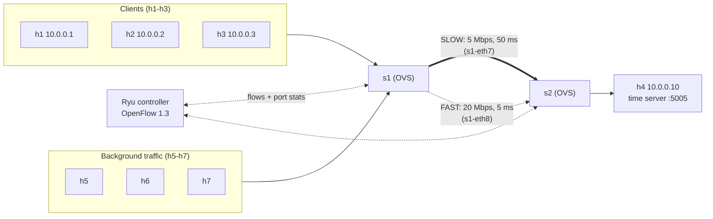
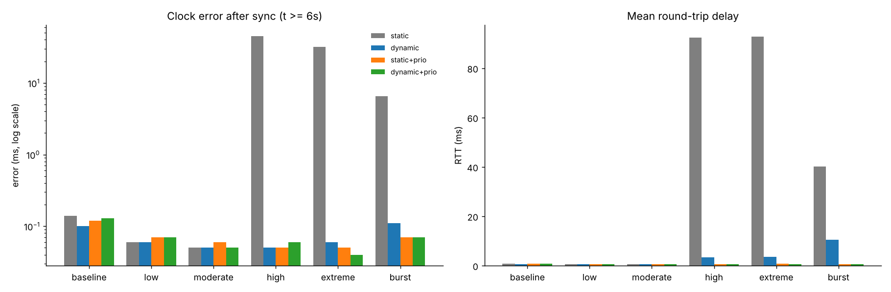
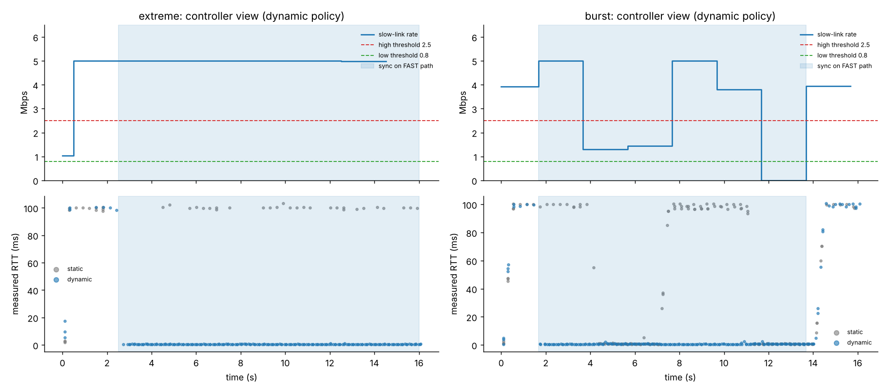

# Network Time Synchronization under Congestion (UDP + Mininet + Open vSwitch + Ryu)

Multiple clients synchronize their clocks with a reference server over **UDP**. The network is
built with **Mininet** and **Open vSwitch** (OpenFlow 1.3) and controlled by a **Ryu** SDN
controller. The controller watches congestion on a slow link and reroutes the synchronization
traffic to a fast link; sync packets can also get a **priority queue**. The experiments measure
how much congestion hurts time synchronization and how well each defence works.

---

## Contents

- [1. Problem statement](#1-problem-statement)
- [2. System architecture and design](#2-system-architecture-and-design)
- [3. Congestion detection and adaptive routing](#3-congestion-detection-and-adaptive-routing)
- [4. Repository structure](#4-repository-structure)
- [5. Installation and setup](#5-installation-and-setup)
- [6. Running the project](#6-running-the-project)
- [7. Final report (PDF)](#7-final-report-pdf)
- [8. Troubleshooting](#8-troubleshooting)
- [9. Performance evaluation](#9-performance-evaluation)
- [10. Team contributions](#10-team-contributions)
- [11. Known limitations](#11-known-limitations)

---

## 1. Problem statement

### How this meets the problem statement

> Build a simplified time-synchronization application using UDP sockets where multiple clients
> synchronize their clocks with a reference server.

| Expectation | How it is done | Where |
|---|---|---|
| **UDP timestamp exchange** | Client sends a request with `t1`; server stamps `t2` (receive) and `t3` (send); client stamps `t4` on arrival | `client.py`, `server.py` |
| **Round-trip delay** | `delay = (t4 - t1) - (t3 - t2)` | `client.py` |
| **Clock offset** | `offset = ((t2 - t1) + (t3 - t4)) / 2`; the client steps its clock using the lowest-delay of its last 8 samples | `client.py` |
| **Multiple clients** | Clients run on h1, h2, h3 at the same time, each starting 0.8 to 2.9 s wrong; the server is one UDP socket | `mininet_experiment.py` |
| **Prioritize sync traffic** | (a) Ryu rewrites the sync flow to use the FAST path when the slow link is busy; (b) Ryu marks sync packets DSCP EF and a Linux `tc` HTB queue serves EF first | `ryu_controller.py`, `mininet_topology.py` |
| **Controlled network delay** | `tc netem` adds 50 ms (slow) and 5 ms (fast) per direction; `tc htb` limits the rate to 5 and 20 Mbps; finite queues | `mininet_topology.py` |
| **Measure sync error** | Each client starts with a known wrong clock and the server holds true time, so the real error is exactly `abs(client offset)` | `client.py` CSV output |
| **Compare under congestion** | 4 policies x 6 traffic scenarios = 24 runs, with CSVs and charts | `mininet_experiment.py` |

Metrics recorded: RTT (mean, p95), jitter, timeout-based loss, clock error (per probe and after
filtering), slow-link throughput, route changes, first reroute time, time spent on the FAST path.

## 2. System architecture and design

### Architecture diagram



## 3. Congestion detection and adaptive routing

### Congestion

Background UDP traffic (3 generators) is pinned to the SLOW link. When its rate
exceeds the link capacity, a queue builds. That queue delays requests going to the server but not
the replies, so forward and return delays differ and the offset is wrong by
`(d_forward - d_return) / 2`. Overflowing the queue also drops sync packets.

### Ryu controller

(`ryu_controller.py`, policy logic in `route_policy.py`)
1. Installs forwarding rules on s1 and s2 when they connect; static ARP is used, so no packet-in handling is needed.
2. Sync traffic (UDP port 5005) has its own priority-20 flow that sets DSCP EF and outputs on the current path. It starts on SLOW. Everything else, including background traffic (UDP 6000), is pinned to SLOW.
3. Every 2 s it requests port statistics for the SLOW port of s1 and converts `tx_bytes` to Mbps.
4. Rate >= 2.5 Mbps moves sync to FAST; rate <= 0.8 Mbps returns it to SLOW. The two thresholds give hysteresis, and at least 4 s must pass between changes.
5. Route changes rewrite the sync flows on both switches. Samples and changes are logged to `logs/*.csv` and `logs/controller_status.json`.

### Policies compared

| Policy | What it does |
|---|---|
| `static` | Sync stays on SLOW, one shared FIFO queue |
| `dynamic` | Ryu moves sync to FAST when the slow link is busy |
| `static+prio` | Stays on SLOW, but DSCP-EF packets use a strict-priority queue |
| `dynamic+prio` | Both |

The runner switches policy between runs through `logs/control.json`, so Ryu does not need restarting.

### Queues

Each inter-switch interface has `htb` (rate limit) with a leaf `netem` (delay and buffer).
With priority enabled there are two classes: EF traffic to a high-priority class, everything else
to best-effort. The priority queue is a Linux `tc` queue, not an OpenFlow queue.

## 4. Repository structure

### Files

| File | Role |
|---|---|
| `ryu_controller.py` | Ryu app: flows, port-stats monitor, congestion policy, logging |
| `route_policy.py` | Threshold / hysteresis / hold-down decision logic (no Ryu dependency) |
| `sdn_config.py` | Addresses, ports, link speeds, thresholds (env-var overridable) |
| `mininet_topology.py` | Topology, `tc` queues; also a standalone Mininet CLI for demos |
| `mininet_experiment.py` | Runs the policy x scenario matrix on Mininet; writes CSVs and charts |
| `client.py`, `server.py`, `common.py` | UDP time-sync client, server, protocol |
| `bg_traffic.py`, `bg_sink.py`, `traffic.py` | Background traffic (constant and burst) and its receiver |
| `report.py` | Builds `final_report.pdf` (NTP offset, delay, clock-error graphs, tables) from a results folder; runs automatically after every experiment |
| `test_route_policy.py` | 8 unit tests for the controller's decision logic |
| `scripts/setup_ubuntu.sh`, `start_controller.sh`, `show_flows.sh` | Setup, start Ryu, show flows and counters |
| `run_sdn_experiment.py`, `sdn_emulator.py`, `emulator.py`, `run_experiment.py` | Optional pure-Python simulation (no Mininet). `mininet_experiment.py` reuses the summary and plotting code from `run_sdn_experiment.py` |
| `dashboard/server.py`, `dashboard/lab.py`, `dashboard/static/` | Web dashboard: starts Mininet, Open vSwitch and Ryu, runs experiments, streams live data to the page (see section 6.1) |
| `scripts/start_dashboard.sh` | Starts the dashboard as root |
| `results_mininet_sandbox/`, `docs/` | Results of the validation run (see section 9) |

## 5. Installation and setup

### 5.1 One-time setup

```bash
bash scripts/setup_ubuntu.sh
```

Installs Mininet, Open vSwitch, ethtool, matplotlib, and Ryu in `~/ryu39-venv` (the recipe is
`pip install 'setuptools<66' wheel pbr`, then `pip install --no-build-isolation ryu eventlet==0.30.2`).
At the end it reports whether your kernel has `sch_htb`, `sch_netem` and the `openvswitch` module.

## 6. Running the project

### 6.1 The dashboard (recommended way to run everything)

One page that starts the lab, runs experiments and draws everything live: four clocks that visibly snap to the
server's time, the t1..t4 exchange for each client, clock error, round-trip delay, link load, a network diagram
and a policy comparison.

```bash
bash scripts/setup_ubuntu.sh           # once, as your normal user (not sudo): Mininet, Open vSwitch, Ryu
./scripts/start_dashboard.sh          # asks for sudo, then open http://127.0.0.1:8000
```

1. Click **Start lab** (starts Open vSwitch, Ryu and Mininet; about 15 seconds).
2. Pick background traffic and a policy, then **Run experiment**. Try *High* + *Static*, then *High* + *Dynamic*.
3. **Compare all policies** runs all 24 combinations (about 10 minutes) and fills the *Compare policies* tab.
4. The *How the mini NTP works* tab has a small calculator that shows why unequal delays cause error.

If Ryu is installed in a virtualenv, set `RYU_MANAGER=/path/to/ryu-manager` before starting. The server only listens on
127.0.0.1 because it controls Mininet as root. Bundled libraries (Chart.js, IBM Plex Sans) are listed in
`dashboard/static/THIRD_PARTY.txt`.

### 6.2 Run the experiments

> **`sudo mn -c` kills `ryu-manager`.** Run any Mininet cleanup *before* starting Ryu.

Terminal 1, the controller:
```bash
cd ~/time-sync-project
sudo mn -c                       # optional cleanup; do this first
./scripts/start_controller.sh
```

Terminal 2, the experiments (Mininet needs root; use the system Python, which has the `mininet` module):
```bash
cd ~/time-sync-project
sudo /usr/bin/python3 mininet_experiment.py            # all 24 runs, about 10 minutes
sudo /usr/bin/python3 mininet_experiment.py --scenarios extreme,burst --policies static,dynamic+prio
sudo /usr/bin/python3 mininet_experiment.py --ryu-manager ~/ryu39-venv/bin/ryu-manager   # starts Ryu itself
```

Results go to `results_mininet/`: `summary.csv`, `raw_samples.csv`, `route_events.csv`,
`controller_samples.csv`, `overview.png`, `timeline.png` and **`final_report.pdf`** (see section 7).
Add `--no-report` to skip the PDF.

Fallback flags: `--no-netem` (kernel lacks `sch_netem`: no link delay), `--datapath user`
(kernel lacks the `openvswitch` module). Other flags: `--duration`, `--queue-pkts`, `--clients`.
Run `sudo /usr/bin/python3 mininet_experiment.py --help` for all of them.

### 6.3 Interactive demo (good for a viva)

```bash
sudo /usr/bin/python3 mininet_topology.py --priority      # Ryu already running in Terminal 1
```
At the `mininet>` prompt:
```text
h4 python3 server.py --host 10.0.0.10 --port 5005 &
h4 python3 bg_sink.py --port 6000 &
h1 python3 client.py --server 10.0.0.10:5005 --skew 2.0 --samples 20 --interval 0.5
h5 python3 bg_traffic.py --target 10.0.0.10:6000 --rate 250 &
h6 python3 bg_traffic.py --target 10.0.0.10:6000 --rate 250 &
h7 python3 bg_traffic.py --target 10.0.0.10:6000 --rate 250 &
h2 python3 client.py --server 10.0.0.10:5005 --skew -1.5 --samples 30 --interval 0.5
sh bash scripts/show_flows.sh
```
The first client runs on a quiet network; the second runs under congestion, and Ryu's log shows
`ROUTE CHANGE -> FAST`. `show_flows.sh` shows the sync flow's output port change from `s1-eth7`
to `s1-eth8`. Drop `--priority` to see the unprotected behaviour.

### 6.4 Unit tests

```bash
python3 test_route_policy.py     # 8 tests of the threshold / hysteresis / hold-down logic
```

## 7. Final report (PDF)

When an experiment finishes, `final_report.pdf` is written next to the CSVs. It contains:

1. Setup, key findings (computed from the numbers) and the full summary table.
2. Overview charts: clock error, round-trip delay and probe loss for every policy and scenario.
3. NTP offset convergence at start-up: how each client's wrong clock is measured and removed.
4. One page per scenario with, for every policy: the **NTP offset θ** of each probe, the **round-trip delay δ**
   (lost probes marked), and the **true clock error** after filtering. Blue shading shows when Ryu had moved
   sync traffic to the FAST path. Below it, the controller's view of the slow link and its thresholds.

```bash
python3 report.py results_mininet                    # rebuild from existing CSVs, no experiment needed
python3 report.py results_sdn --out my_report.pdf    # works on the pure-Python simulation results too
```

In the dashboard, **Download final report (PDF)** appears in the *Live run* tab (single run) and the *Compare
policies* tab (after *Compare all policies*). It is saved in `results_dashboard/last_run/` and
`results_dashboard/last_matrix/`. Needs `python3-reportlab` (installed by `scripts/setup_ubuntu.sh`; otherwise
`pip install reportlab pillow matplotlib`). `docs/sample_final_report.pdf` is an example built from the sandbox results.

## 8. Troubleshooting

| Symptom | Cause and fix |
|---|---|
| "switches did not connect to the controller" | Ryu is not running, or `sudo mn -c` killed it. Start Ryu *after* any cleanup |
| ping works but all sync probes are lost | Checksum offload with the userspace datapath. The code already runs `ethtool -K ... tx off rx off`; make sure `ethtool` is installed |
| `Specified qdisc kind is unknown` / `RTNETLINK` errors | The kernel lacks `sch_htb` or `sch_netem`. Run `--no-netem`, or load the modules with `sudo modprobe sch_netem` |
| `ModuleNotFoundError: mininet` | Run with `/usr/bin/python3`, not the Ryu virtualenv |
| `ryu-manager` build fails | Use the recipe in section 5.1 (`pbr`, `setuptools<66`, `--no-build-isolation`) |
| Stale interfaces after a crash | `sudo mn -c`, then restart Ryu |

## 9. Performance evaluation

### 9.1 What was tested, and what was not

I built and ran this on real Ryu 4.34 (Python 3.9), Open vSwitch 3.3.9 and Mininet in a Linux
sandbox. That sandbox had **no Open vSwitch kernel module and no `netem`**, so the validation used the userspace
datapath (`--datapath user`) with `--no-netem`.

| Verified | Not verified |
|---|---|
| Ryu loads the controller, switches connect, flows install | Kernel OVS datapath |
| Port-stats monitoring, thresholds and route changes at runtime (logs and charts) | `tc netem` link delay (the 50 ms and 5 ms delays) |
| Sync exchange over UDP across the topology; a 2 s clock error corrected to about 0.05 ms | Behaviour of the queue buffer when `netem` shares it |
| HTB rate limits, DSCP-EF to priority class filter | Your VM's exact numbers |
| Policy switching between runs; auto-start of Ryu (`--ryu-manager`) | |
| All 24 runs of the matrix | `scripts/setup_ubuntu.sh` as a whole (its steps were run by hand, and the script only syntax-checked) |
| Interactive CLI demo (same commands as section 6.3, in a slightly different order) | Python 3.10 (Ubuntu 22.04's default) with Ryu; the sandbox used 3.9 |
| 8 policy unit tests | |

### 9.2 Validation results (userspace datapath, no netem: delays here are queueing only)

3 clients, 16 s per run, one run per cell. "Steady error" = clock error after the filter at t >= 6 s.

| Scenario | Policy | Mean RTT (ms) | Probe loss | Steady error (ms) | Route changes |
|---|---|---:|---:|---:|---:|
| baseline | any | 0.7 to 0.8 | 0% | 0.1 | 0 |
| moderate (3 Mbps) | any | 0.5 | 0% | 0.05 | 0 (1 for both dynamic policies) |
| high (6 Mbps) | static | 92.5 | 28.1% | 45.2 | 0 |
| high | dynamic | 3.4 | 0.9% | 0.05 | 1 |
| high | static+prio | 0.56 | 0% | 0.05 | 0 |
| high | dynamic+prio | 0.54 | 0% | 0.06 | 1 |
| extreme (9 Mbps) | static | 92.8 | 43.1% | 31.6 | 0 |
| extreme | dynamic | 3.5 | 2.3% | 0.06 | 1 |
| extreme | static+prio | 0.72 | 0% | 0.05 | 0 |
| extreme | dynamic+prio | 0.52 | 0% | 0.05 | 1 |
| burst | static | 40.3 | 6.1% | 6.6 | 0 |
| burst | dynamic | 10.6 | 1.4% | 0.11 | 2 |
| burst | static+prio | 0.57 | 0% | 0.07 | 0 |
| burst | dynamic+prio | 0.59 | 0% | 0.07 | 3 |

Full table (24 rows) is in `results_mininet_sandbox/summary.csv`; charts are `docs/mininet_overview.png` and `docs/mininet_timeline.png`.




### 9.3 What the results show

1. With no protection (`static`), overload of the 5 Mbps link builds a roughly 100 ms queue, loses 28 to 43% of sync probes and leaves tens of ms of clock error.
2. `dynamic` fixes it after the controller notices: the first reroute happens 1.4 to 2.8 s into the run. Probes sent before that still suffer, which is where its remaining loss comes from.
3. `+prio` protects from the first packet, because the queue is bypassed immediately.
4. In this sandbox the two paths have no delay difference, so reroute and priority look equally good. On your VM, `netem` makes the SLOW path about 100 ms RTT and the FAST path about 10 ms, so rerouting should also cut the base latency, which priority alone cannot. Expect different absolute numbers there.
5. `moderate` (3 Mbps) is below the 5 Mbps capacity, so there is no queue and static is fine, but the controller still reroutes because 3 Mbps is above its 2.5 Mbps threshold.

If you do not see a congestion effect once `netem` is enabled, raise `--queue-pkts` (for example to 120): `netem` holds packets in its delay line, which leaves less room for queueing.

### 9.4 Dashboard testing

The dashboard was tested in a sandbox with real Mininet, Open vSwitch (userspace datapath) and Ryu: a full run through the browser, the Compare and How-it-works tabs, light and dark themes, and phone width, with no browser errors. Not tested: the kernel Open vSwitch datapath and `tc netem` delay (the sandbox kernel lacks both), and Kali Linux. The dashboard falls back automatically when either is missing, and the Compare tab shows sample results from the sandbox until you run your own comparison.

## 10. Team contributions

### Team Members and Contributions

| Team Member | SRN | Contributions |
|---|---|---|
| **Patel Arya Ajaykumar** | PES1UG25CS361 | **Integration, Testing and SDN Development:** Integrated the client and server code supplied by the team into the complete system and tested it end to end. Built the Mininet topology with two Open vSwitch switches, slow and fast links, and a Ryu controller that moves time-sync traffic to the fast path when the network gets crowded. Developed the Ryu OpenFlow 1.3 controller with port-statistics monitoring, threshold and route changes, and the static, dynamic and priority policies. Wrote the background traffic generators, the 24-run policy x scenario experiment runner, the web dashboard, the final PDF report generator, the setup and start scripts. Ran and analysed the experiments and prepared the documentation. |
| **Nadella Harshith** | PES1UG25CS319 | **Client-Side Development:** Developed the UDP time synchronization client in C. Implemented socket communication between clients and the time server. Worked on sending synchronization requests, receiving server responses, recording timestamps and calculating synchronization-related measurements. Contributed to client-side result collection and logging to evaluate synchronization performance under different network conditions. |
| **Nihar Nandan Reddy** | PES1UG25CS336 | **Server-Side Development:** Developed the UDP time synchronization server in C. Implemented socket creation, binding, request reception and response transmission. Handled timestamp generation and exchange between the server and clients. Contributed to the server-side communication logic required for calculating round-trip time and clock offset during synchronization experiments. |
| **All Team Members** | — | **Integration, Testing and Project Demonstration:** Collaborated to integrate the Ryu controller, Mininet network topology, UDP client-server applications and Flask dashboard. Participated in debugging, testing and validating the complete system. Conducted network experiments under different traffic and congestion conditions, verified adaptive path switching and synchronization performance, and contributed to project documentation, screenshots, GitHub repository preparation and final demonstration. |
## 11. Known limitations

- One run per cell of 16 s; small differences are noise, and the static error varies run to run.
- Clients are Python (not C). The dashboard uses only the Python standard library (no Flask). There is no TCP/iperf traffic, SQLite history or PDF reports. These can be added on top.
- The controller decides from slow-link throughput only (not RTT or loss) and reacts at most every 2 s.
- The priority queue is a Linux `tc` queue keyed on DSCP, not an OpenFlow queue.
- Congestion is applied to the client-to-server direction only, which is also where the background traffic flows.
- No clock drift: the client's clock is stepped once per probe and stays correct between probes.
